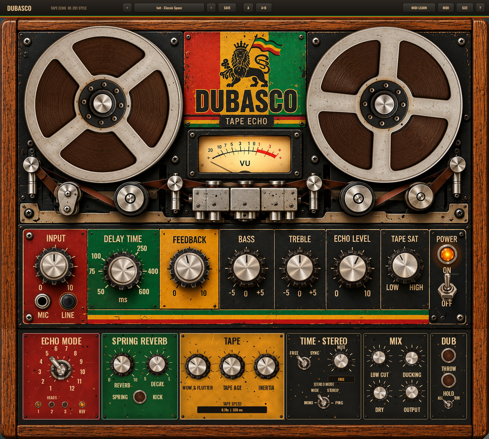

# DUBASCO Tape Echo

Ein Bandecho-Plugin im Stil des Roland RE-201 Space Echo (1974), gemacht für jamaikanischen und britischen Dub.
Formate: **VST3** (Ableton, Windows/macOS), **Audio Unit** (Logic, macOS) und eine **Standalone**-App.



## Klang: was das Plugin nachbildet

- **Echtes Bandmodell statt digitalem Delay.** Das Band ist ein Puffer, der nach Bandposition adressiert wird. Ein Motor bewegt
  das Band, ein Aufnahmekopf schreibt, drei Wiedergabeköpfe lesen im Abstand 1 : 2 : 3. Dreht man DELAY TIME, ändert sich die
  Bandgeschwindigkeit, und alles auf dem Band pitcht hoch oder runter, mit einstellbarer Motorträgheit. Das ist der klassische
  Dub-Effekt beim Drehen am Repeat-Rate-Regler.
- **12 Modi wie am RE-201:** 1 bis 4 nur Echo (Kopf 1, 2, 3, 2+3), 5 bis 11 Echo mit Federhall (Kombinationen aller Köpfe), 12 nur Hall.
- **Feedback-Schleife mit Bandsättigung:** Pre-/De-Emphasis, asymmetrische Sättigung, Head-Bump, Höhenverlust. Jede Wiederholung wird
  dunkler und wärmer. Ab etwa Feedback 7 geht das Band in die Eigenschwingung, die Sättigung hält das musikalisch (kein digitales Clipping).
- **Federhall:** drei Federn mit dispersiven Allpass-Ketten (das typische "Boing"/"Drip"), dazu **KICK**: ein Tritt gegen den
  Hallspiralen-Tank.
- **Wow & Flutter, Tape Age** (Höhenverlust, Bandrauschen, Dropouts), **Tape Stop** beim Ausschalten: Das Band läuft hörbar aus.
- **Bass/Treble im Echo-Kreis** (wie am Gerät), zusätzlicher Low Cut, Ducking, Dry-Regler (0 = 100 % Effekt für Send-Kanäle).

## Bedienelemente

| Bereich | Regler |
|---|---|
| Hauptpanel (wie auf dem Bild) | INPUT, MIC/LINE-Buchsen (anklickbar), DELAY TIME, FEEDBACK, BASS, TREBLE, ECHO LEVEL, TAPE SAT, POWER-Schalter mit Lampe, VU-Meter (Klick: IN/ECHO/OUT) |
| Animation | drehende Bandspulen (Tempo = Bandgeschwindigkeit, laufen beim Ausschalten aus), VU-Nadel mit VU-Ballistik, glühende Lampen, Hebelschalter und Kippschalter animiert |
| Dub Section (neu) | ECHO MODE (12-fach-Wahlschalter + Kopf-Lampen), SPRING REVERB (Level, Decay, KICK), TAPE (Wow & Flutter, Tape Age, Inertia, Geschwindigkeitsanzeige), TIME (FREE/SYNC, Notenwert inkl. punktiert/Triole), STEREO (Mono, Wide, Stereo, Ping-Pong), MIX (Low Cut, Ducking, Dry, Output), DUB (THROW, HOLD, Send-Modus) |
| Obere Leiste | Presets (vor/zurück, Menü, speichern, löschen), A/B-Vergleich, MIDI LEARN, MIDI-Menü, Fenstergröße 45 bis 120 % (frei ziehbar), Hilfe (?) |

**Dub-Performance:**
- **THROW** bei Send-Schalter **THR**: Nur solange gedrückt geht Signal ins Echo, der klassische Dub-Throw auf Snare oder Vocal.
  Bei **ALL**: THROW lässt das Feedback anschwellen (Runaway auf Knopfdruck).
- **HOLD**: Eingang zu, Band läuft endlos weiter (Freeze).
- **KICK**: Federhall-Crash.

## Standard-Plugin-Funktionen

- Alle 27 Parameter automatisierbar, mit Klartext-Werten (ms, Hz, dB)
- Host-Bypass (VST3/AU-Bypass-Parameter, mit Überblendung), Tail-Länge gemeldet
- Mono- und Stereo-Spuren, beliebige Samplerates (getestet 44,1 bis 192 kHz), 0 Samples Latenz
- Session-State speichert alles: Parameter, MIDI-Mappings, Preset-Name, Fenstergröße, VU-Quelle
- 16 Factory-Presets (auch als Host-Programme), User-Presets als Dateien in `Dokumente/Dubasco/Tape Echo Presets`
- Tempo-Sync zur DAW
- Skalierbares Fenster (seitenverhältnisfest), Retina/HiDPI-Grafik
- Rechtsklick auf jeden Regler: MIDI Learn, Mapping löschen, Reset, Host-Menü (z. B. Automation anzeigen)
- Doppelklick setzt Regler zurück, Mausrad auf allen Reglern und Wahlschaltern

## MIDI Learn

1. Oben **MIDI LEARN** anklicken: alle lernbaren Regler werden grün umrandet.
2. Regler anklicken (blinkt orange) und am Controller einen Knopf, Fader oder Pad bewegen. Fertig, das Mapping steht als Etikett am Regler.
3. Noch einmal MIDI LEARN, um den Modus zu verlassen. Alternativ: Rechtsklick auf einen Regler, dann "MIDI Learn".

CCs steuern Regler stufenlos, Schalter schalten bei Wert 64 und mehr. Noten und Pads funktionieren auch: THROW und KICK reagieren
momentan (Note an/aus), Schalter wechseln bei jedem Anschlag, ECHO MODE springt zum nächsten Modus. Mappings werden mit dem
Projekt gespeichert. Unter **MIDI > Save mappings as default** gelten sie für jede neue Instanz.

**MIDI zum Plugin:** Das Plugin öffnet selbst alle MIDI-Eingänge des Rechners und hört direkt auf deine Controller,
ohne Routing im Host (abschaltbar im MIDI-Menü). Die grüne Lampe am MIDI-Knopf zeigt eingehende Daten, das MIDI-Menü listet
die Geräte und die letzte Nachricht. Kommt derselbe Controller zusätzlich über den Host (z. B. Ableton "MIDI To"), wird das
Doppel erkannt und verworfen. Unter Windows kann ein Controller, den Ableton bereits als Eingang nutzt, gesperrt sein:
dann in Ableton eine MIDI-Spur mit Input = Controller und "MIDI To" = Plugin-Spur / "Dubasco Tape Echo" anlegen.

## Bauen

Voraussetzungen: CMake 3.22 oder neuer, ein C++17-Compiler (Xcode auf macOS, Visual Studio 2022 auf Windows). JUCE 8 wird
automatisch heruntergeladen.

```bash
cmake -B build -DCMAKE_BUILD_TYPE=Release          # macOS: zusätzlich -G Xcode
cmake --build build --config Release
```

Ergebnis in `build/DubascoTapeEcho_artefacts/Release/` (VST3, AU, Standalone).

**Automatische Builds:** `.github/workflows/build.yml` baut bei jedem Push auf GitHub macOS (Universal: Apple Silicon und Intel,
VST3 + AU + App, ad-hoc signiert, mit `auval` und pluginval geprüft), Windows (VST3 + exe) und Linux. Die fertigen ZIPs liegen
im Actions-Tab unter "Artifacts". Bei einem Tag `v1.0.0` entsteht automatisch ein GitHub-Release.

Tests: `cmake -B build -DDUBASCO_BUILD_TESTS=ON` baut `DubascoRender` (DSP-Tests plus Demo-WAVs) und `DubascoSnapshot` (rendert die
Oberfläche als PNG).

## Projektstruktur

```
Source/dsp/TapeEchoEngine.*   Bandmodell, Köpfe, Feedback, Stereo-Routing, Tape Stop (reines C++, ohne JUCE)
Source/dsp/SpringReverb.h      Federhall
Source/PluginProcessor.*        Parameter, Tempo-Sync, State, Programme
Source/MidiLearn.*              MIDI Learn (lock-free auf dem Audio-Thread)
Source/PresetManager.*          Factory/User-Presets, A/B
Source/PluginEditor.*, gui/     Oberfläche, Animationen, Overlays
tools/gen_assets.py             erzeugt alle Grafiken aus assets_src/ und Source/Layout.h
assets_src/                     Original-Grafiken (Mockup, ausgeschnittene Regler)
```

## Lizenz-Hinweis

Gebaut mit JUCE 8 (AGPLv3 oder kommerzielle JUCE-Lizenz) und dem VST3-SDK (MIT). Für den privaten Gebrauch ist das unproblematisch.
Wer das Plugin verkaufen oder als Closed Source verteilen will, braucht eine passende JUCE-Lizenz. "Roland" und "Space Echo" sind
Marken der Roland Corporation, das Plugin ist eine unabhängige Nachbildung des Klangcharakters.

## WordPress-Version

Unter [`wordpress/`](wordpress/) liegt das WordPress-Plugin „Dub Echo Plugin“: dieselbe Engine und
Optik im Browser, mit MP3-Playlist, Likes und Statistik. Details in [`wordpress/README.md`](wordpress/README.md).
